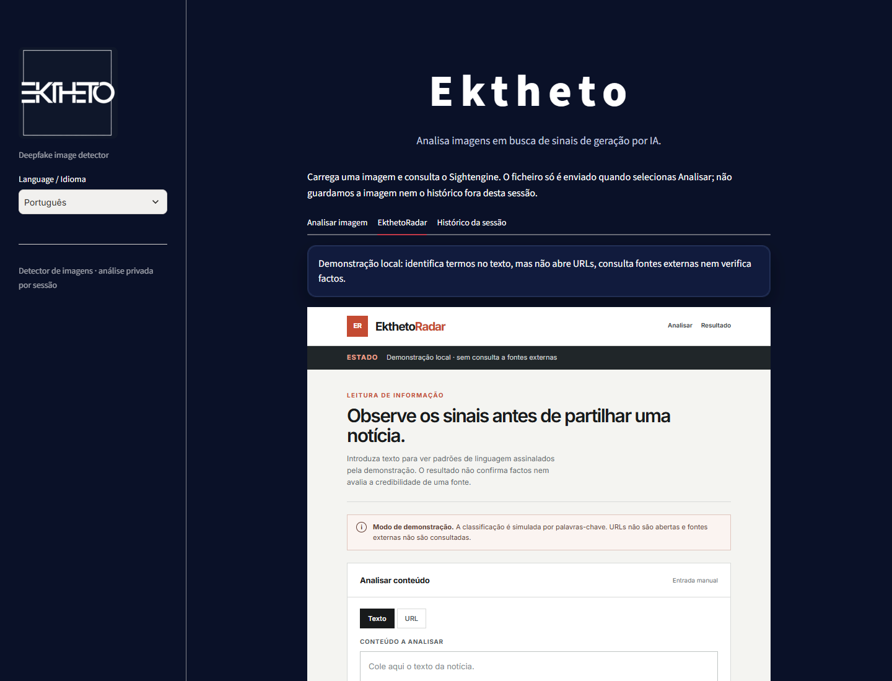

# Ektheto 🛡️



> **Expor o que é falso. Revelar o que é real.**

O **Ektheto** é uma aplicação Streamlit para analisar imagens e identificar sinais associados a conteúdo gerado por inteligência artificial. A interface valida o formato, o tamanho e as dimensões do ficheiro antes de enviar a imagem para a API do Sightengine. O resultado é apresentado como um indicador automatizado, acompanhado de um aviso de que não constitui prova de autenticidade.

A aplicação também inclui o **EkthetoRadar**, uma demonstração para identificar termos e comparar grafias de domínio com um catálogo limitado. Não abre páginas, consulta fontes externas nem verifica factos. A interface usa uma hierarquia editorial própria, inspirada em páginas de agências de informação, sem reutilizar marcas ou conteúdo de terceiros.

## Executar localmente

```powershell
python -m pip install -r requirements.txt
python -m playwright install chromium
streamlit run app.py
```

Configure `SIGHTENGINE_USER` e `SIGHTENGINE_SECRET` no ficheiro `.env`, na raiz do projeto. Mantenha esse ficheiro fora do Git.

No Streamlit Community Cloud, configure os mesmos nomes em **App settings → Secrets**:

```toml
SIGHTENGINE_USER = "o-seu-api-user"
SIGHTENGINE_SECRET = "o-seu-api-secret"
```

Use o par **API User** e **API Secret** da página de chaves do Sightengine, sem espaços adicionais. A aplicação lê primeiro os Secrets do Streamlit e usa o ambiente local como fallback.

## Atualizar a captura

Com a aplicação aberta em `http://localhost:8501`, execute:

```powershell
python capturar.py
```

O script usa Playwright para guardar uma captura de página inteira em `assets/ektheto-app-screenshot.png`. Para definir outro endereço, use a variável `EKTHETO_APP_URL`.

## Simular visitas diárias

Com a aplicação aberta, execute o teste de saúde, que simula 100 visitas distribuídas ao longo de 24 horas e grava `relatorio_carga.json`:

```powershell
python carga_diaria.py
```

Para uma verificação rápida, reduza a janela, por exemplo `python carga_diaria.py --users 5 --window-hours 0.001`. O script só aceita `localhost` por predefinição. Um endereço remoto exige a opção explícita `--allow-remote`; use-a apenas num ambiente que tem autorização para testar. A simulação faz pedidos ao endpoint de saúde do Streamlit e não carrega imagens nem chama o Sightengine.
